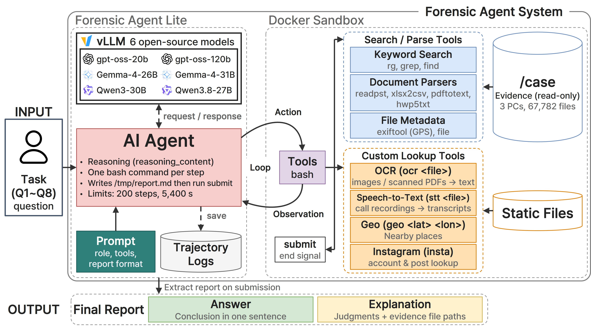

# Forensic Agent Lite



Forensic Agent Lite is a data generation environment built to analyze how open-source LLM agents reason through a digital forensic investigation and reach their conclusions. Running on [mini-swe-agent](https://github.com/SWE-agent/mini-swe-agent), the agent investigates the HYENA 2021 evidence data with a single bash tool and submits a report in a fixed format. Each run is saved as one trajectory (`traj.json`) containing the reasoning, command, and observation of every step, along with the final report.

## Structure

```
.
├── requirements.txt          mini-swe-agent and litellm versions
└── exp/
    ├── case.yaml             agent configuration: prompt, limits, sandbox, model
    ├── tasks/                8 investigation tasks (q1.md ~ q8.md)
    ├── Dockerfile            sandbox image (forensics-case)
    ├── osint/                tools and data installed in the sandbox
    │   ├── ocr, stt          OCR of images and scanned PDFs, transcripts of audio files
    │   ├── geo, insta        places near coordinates, Instagram lookup (offline)
    │   ├── submit            submits /tmp/report.md as the final report
    │   └── data/             data read by the tools above
    ├── ocr_build/
    │   ├── verify_evidence.sh  checks that the evidence files match the OCR/STT data
    │   └── ocr_index.tsv       files to check and their SHA-1
    └── run.sh                runs one model on the 8 tasks N times
```

## Requirements

- Linux or WSL2, Docker
- Python 3.10 or later
- A GPU to run vLLM
- HYENA 2021 evidence data

## Usage

### 1. Install

```bash
python3 -m venv .venv && source .venv/bin/activate
pip install -r requirements.txt
```

### 2. Verify the evidence data

`ocr` and `stt` look up results by the SHA-1 of the file content. If an evidence file differs, no result is found for it, so check first.

```bash
bash exp/ocr_build/verify_evidence.sh /path/to/hyena_ctf
# checked 2110, mismatched 0
```

### 3. Prepare the sandbox

```bash
docker build -t forensics-case exp
```

Replace `/path/to/hyena_ctf` in `exp/case.yaml` with your evidence folder. The evidence is mounted read-only at `/case`, and the sandbox runs without network access.

### 4. Start the model server

The agent calls a vLLM server at `http://127.0.0.1:8000/v1`.

```bash
vllm serve <model> --port 8000 --max-model-len 131072 <model-specific options>
```

| Model | Model-specific options |
|---|---|
| openai/gpt-oss-20b, openai/gpt-oss-120b | `--tool-call-parser openai --enable-auto-tool-choice` |
| Qwen/Qwen3.8-27B | `--reasoning-parser qwen3 --tool-call-parser qwen3_xml --enable-auto-tool-choice` |
| Qwen/Qwen3-30B-A3B-Thinking-2507 | `--reasoning-parser deepseek_r1 --tool-call-parser hermes --enable-auto-tool-choice` |
| google/gemma-4-26B-A4B-it, google/gemma-4-31B-it | `--reasoning-parser gemma4 --tool-call-parser gemma4 --enable-auto-tool-choice --default-chat-template-kwargs '{"enable_thinking":true}'` |

### 5. Run

Run from the repository root.

```bash
bash exp/run.sh <model> <name> [reps=5] [jobs=4]

# examples
bash exp/run.sh openai/gpt-oss-20b high
CFG=model.model_kwargs.reasoning_effort=low bash exp/run.sh openai/gpt-oss-20b low
```

`<name>` is the name of the output folder. `CFG` overrides a value in `case.yaml`. The reasoning conditions used in the experiments are:

| Model | HIGH | LOW |
|---|---|---|
| gpt-oss | default (`reasoning_effort: high`) | `CFG=model.model_kwargs.reasoning_effort=low` |
| Qwen3.8-27B | `CFG=model.model_kwargs.reasoning_effort=medium` | `CFG=model.model_kwargs.reasoning_effort=low` |
| Qwen3-30B-A3B-Thinking | default (always reasons) | none |
| gemma-4 | default (reasoning enabled on the server) | `CFG='model.model_kwargs.extra_body={"chat_template_kwargs": {"enable_thinking": false}}'` |

### 6. Output

```
runs/<model>/<name>/q<task>/r<rep>.traj.json
runs/<model>/<name>/q<task>/r<rep>.log
```

`traj.json` contains the full conversation (including `reasoning_content`), the exit status (`info.exit_status`), the submitted report (`info.submission`), and the full configuration used for the run (`info.config`). Running the same command again skips finished runs.

## Run settings

| Setting | Value |
|---|---|
| Step limit | 200 |
| Time limit | 5,400 s |
| Command timeout | 120 s |
| Output length | over 10,000 characters, only the first and last 5,000 are shown |
| temperature | 1.0 |
| Tool calls | `tool_choice: required` (every response is a bash call) |

The agent writes the report to `/tmp/report.md` in the format `## Conclusion` (one sentence) and `## Findings` (claims with evidence file paths), then submits it with `submit`.
